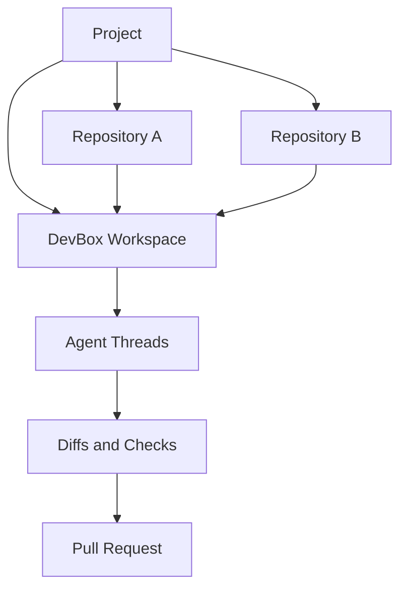

## The Core Mental Model

SeaSnoke is organized around DevBox workspaces. A DevBox workspace is the durable place where an agent works on a project: it has repository checkouts, runtime state, environment setup, logs, agent messages, diffs, checks, and pull request handoff.

If a local agent tool gives each agent a git worktree, SeaSnoke gives each agent a cloud DevBox. The useful mapping is:

| Local agent workspace | SeaSnoke |
| --- | --- |
| Git worktree | DevBox workspace checkout |
| Terminal tab | Console log or future live shell |
| Agent chat | Workspace thread |
| Branch diff | Review artifact |
| Local setup | Recreated environment |
| Local machine state | Docker or MicroVM-backed runtime |
| Manual merge | Verified pull request handoff |

SeaSnoke does not require users to care whether the runtime is Docker or MicroVM for normal V1 usage. The backend selects the configured runtime path, and the workspace UI keeps the user focused on the work: what the agent is doing, what changed, what passed, and what needs review.

## Project, Repository, Workspace

SeaSnoke separates three levels:

- **Project:** the product or system being worked on.
- **Repository:** one codebase connected to the project.
- **Workspace:** one active DevBox session where agents perform work across one or more project repositories.

A project can contain multiple repositories. A workspace can attach the repositories needed for a task, recreate their environment, and keep all agent output tied to one review surface.

## What a Workspace Contains

A DevBox workspace should make the state of agent work inspectable without switching tools.

Common workspace sections include:

- **Overview:** task goal, project, repositories, branch, current status, and active agent.
- **Threads:** planner, worker, reducer, verifier, and user conversation history.
- **Graph:** dependencies between agent roles and retry state.
- **Environment:** detected stack, services, ports, setup commands, snapshot, and runtime backend.
- **Console:** raw output, streamed logs, and setup or verification errors.
- **Source Control:** changed files, inline diff, verifier notes, checks, and pull request actions.

The workspace is the product surface. Runs, tasks, graph nodes, logs, and diffs are implementation details that hang off the workspace.

## Environment Rebuild and Snapshot

SeaSnoke workspaces should be able to recreate the environment needed for the code to run. That includes installing dependencies, starting services, applying setup commands, and discovering ports.

When setup succeeds, SeaSnoke can snapshot the environment so later runs do not start from zero. Snapshots make repeated agent work faster and more reliable because the platform can reuse a known-good base rather than repeatedly rediscovering the same project setup.

Environment state should be visible:

- **Creating:** dependencies and services are being installed or started.
- **Ready:** the workspace can run agent tasks and checks.
- **Failed:** setup failed and needs logs or configuration changes.
- **Snapshotted:** a reusable environment image is available.
- **Stale:** repository or configuration changes mean the snapshot should be rebuilt.

## Runtime Backends

SeaSnoke supports more than one execution backend. Docker is useful as the V1 deployment fallback because it gets users into live workspaces quickly. MicroVMs remain the stronger isolation target when the host supports them.

The UI should not present Docker and MicroVMs as equivalent security models. For normal users, the workspace should simply show whether the DevBox is ready. For operators and administrators, runtime details can appear in diagnostics, environment panels, and deployment notes.

## How This Changes Review

Review is not just "look at a generated patch." Review happens inside the workspace, with the surrounding evidence attached:

- the task prompt and follow-up messages
- the agent thread that produced the change
- setup and validation logs
- changed files and diff comments
- failed worker retries
- reducer and verifier decisions
- pull request state

This makes a workspace closer to a complete engineering handoff than a temporary code generation session.
