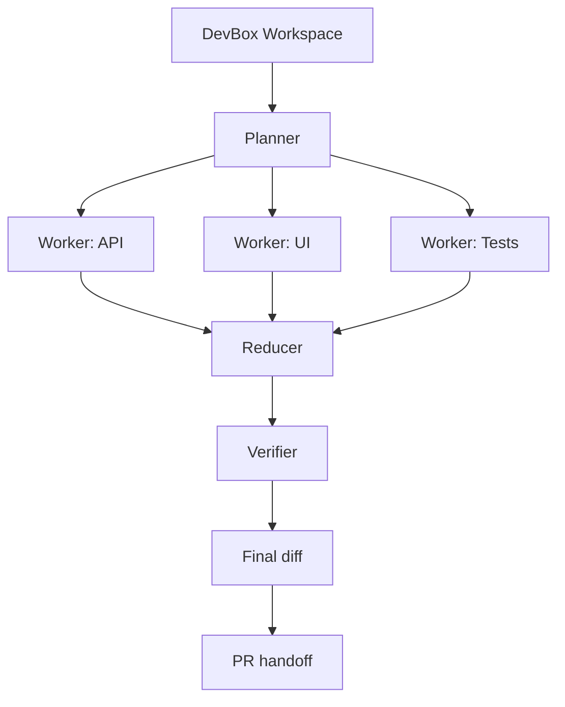

## What is the Review Graph?

The Review Graph shows how agent threads inside a DevBox workspace produced a candidate change. It helps reviewers understand the planner, worker, reducer, and verifier path before deciding what should move forward.

It is designed for tasks where a simple linear history is not enough. A workspace may have retries, alternative approaches, parallel workers, follow-up runs, or candidates that were abandoned after review. The Review Graph keeps those attempts visible without forcing every attempt into the final branch history.

## What You Can Inspect

Each graph item shows status, checks, files changed, logs, and diff size. Select a thread or candidate to inspect the full diff, test output, console logs, and review notes.

The Review Graph is useful because it connects review signals that are usually scattered across tools:

- the workspace that owns the change
- the task that requested the outcome
- the agent thread that produced the candidate
- the environment state used for validation
- the changed files
- validation output
- agent notes
- reviewer decisions
- pull request state, when a candidate moves forward

## Thread and Candidate Cards

Thread and candidate cards summarize the information a reviewer needs before opening the full diff.

Typical fields include:

- role, such as planner, worker, reducer, or verifier
- thread status
- candidate identifier
- number of files changed
- additions and deletions
- check status
- creation time
- final summary
- retry count
- reviewer decision

Use the card to decide where to spend attention. A failed worker with useful partial output may need a targeted retry. A reducer with conflicting patches may need review before verifier work continues. A small verified candidate may be ready for source review.

## Diff Review

The diff is the source of truth. Notes and check output help, but reviewers should still inspect the code that would enter the repository.

When reviewing a candidate, check:

- whether the changed files match the task scope
- whether unrelated formatting or churn was introduced
- whether public interfaces changed
- whether errors are handled explicitly
- whether tests cover the behavior that matters
- whether documentation or examples need to change

For API changes, confirm the request and response shapes are intentional. For frontend changes, confirm loading, empty, error, and mobile states. For worker or automation changes, confirm retry behavior and failure reporting. For environment changes, confirm setup, services, ports, and snapshots are intentional.

## Validation Results

Validation results show what was checked against the candidate inside the workspace. These can include tests, lint, type checks, formatting, security checks, setup commands, service health checks, or custom repository commands.

Passing validation means the configured checks passed. It does not prove the implementation is correct in every environment. Failing validation does not always mean the idea is wrong; it may reveal a missing dependency, flaky test, or incomplete setup.

Useful validation output answers:

- what command ran
- whether it passed or failed
- how long it took
- what logs or errors matter
- whether the failure is related to the candidate

## Review Decisions

SeaSnoke separates candidate generation from review decisions. A reviewer can select a candidate, request another run, leave notes, or decide that no candidate should move forward.

Common decisions:

- **Select:** this candidate should become the proposed change.
- **Revise:** the candidate is close, but needs another pass.
- **Reject:** the approach should not move forward.
- **Hold:** more product or engineering context is needed.
- **Retry thread:** a failed worker or verifier should rerun with additional instructions.

This makes review history useful later. Teams can see not only what was merged, but which alternatives were considered and why they were not chosen.

## Practical Review Flow

1. Open the workspace and confirm the requested outcome.
2. Scan the planner, worker, reducer, and verifier threads.
3. Retry failed workers only when their failure is recoverable.
4. Inspect the strongest candidate diff.
5. Read validation output and console logs for relevant checks.
6. Compare against another candidate if the decision is not obvious.
7. Select, revise, retry, or reject with a short reason.

Short review notes are enough. The goal is to make future readers understand the decision without writing a separate report.
