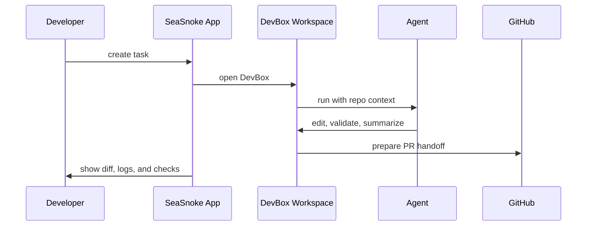

## 1. Sign In

Open your SeaSnoke workspace in the browser:

<a href="https://app.seasnoke.com">https://app.seasnoke.com</a>

## 2. Connect GitHub

Install the SeaSnoke GitHub App from the project connection flow. SeaSnoke uses that installation to list repositories, read repository context, and open pull requests after review.

For V1, GitHub is the primary repository provider.

## 3. Create a Project

Create a project and attach one or more repositories. A project represents the product or system. A workspace is created from that project when an agent starts working.

Good first projects use a repository that already has clear setup instructions and checks.

## 4. Start a Workspace

Create a task with a narrow outcome, then start the workspace.

```md
Add tests for the billing date parser.

Requirements:
- Cover month-end rollover.
- Cover invalid date input.
- Run the existing parser test suite.
```

SeaSnoke opens a DevBox workspace, prepares the repository checkout, recreates the environment, and starts the agent thread.

## 5. Review the Result

Open the workspace page to inspect:

- agent thread messages
- console logs
- environment state
- changed files and diffs
- validation output
- pull request handoff


