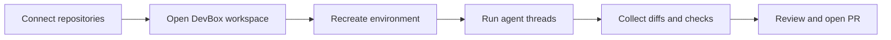

SeaSnoke is an AI coding platform for giving agents cloud DevBox workspaces, letting them rebuild project environments, and moving only reviewed changes into your repositories.

## What is SeaSnoke?

SeaSnoke helps teams hand real software work to coding agents without losing review control. You connect repositories, open a DevBox workspace, let agents work in isolated runtime environments, and review the resulting diffs, logs, checks, and pull requests in one place.

Think of it as a cloud-native agent workbench: projects, repos, DevBox sessions, agent threads, environment snapshots, diffs, checks, and review decisions in one place.

## Key Features

- **DevBox Workspaces**: Give each task a durable workspace with repository context, runtime state, logs, and review artifacts.
- **Reproducible Environments**: Recreate project dependencies and services, then snapshot successful environments for future runs.
- **Agent Threads and Graphs**: Split large tasks into planner, worker, reducer, and verifier threads when parallel work is useful.
- **Reviewable Diffs**: Inspect files, console output, checks, summaries, and pull request handoff before anything lands.
- **Protected Execution**: Run agent work away from production systems using the configured Docker or MicroVM backend.

## How It Works

1. **Connect Repositories**: Link GitHub repositories to a project so SeaSnoke has the code and review target.
2. **Open a DevBox Workspace**: SeaSnoke prepares an isolated checkout for the task, including runtime and environment metadata.
3. **Run Agent Threads**: A single agent can work linearly, or a larger task can split into planner, worker, reducer, and verifier threads.
4. **Validate the Result**: Tests, linting, setup commands, and verifier feedback attach to the workspace.
5. **Review and Handoff**: Review the final diff, inspect logs and decisions, then open or update a pull request.
